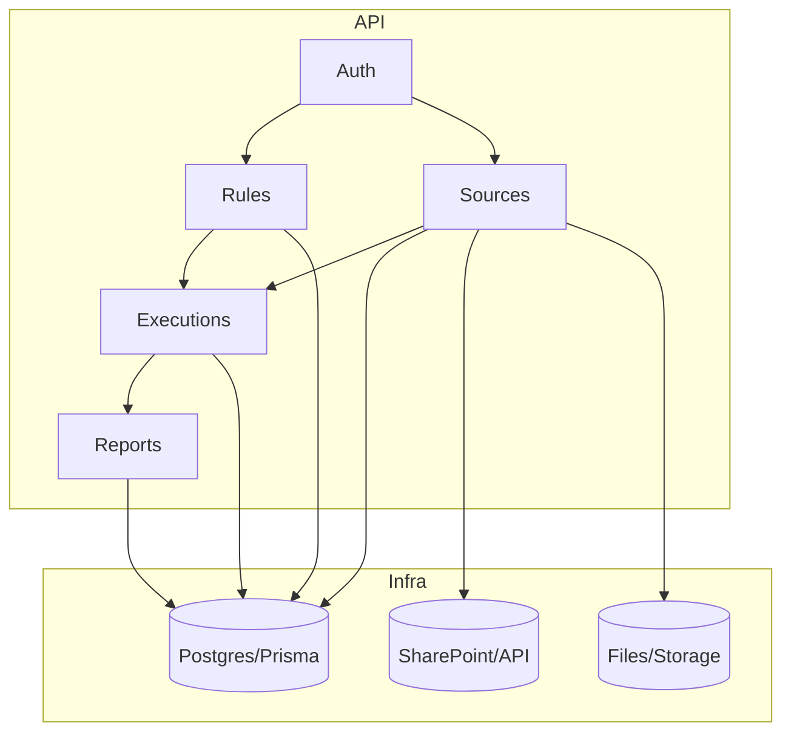

# ConsolidaHub - Arquitetura

## Visão Geral

ConsolidaHub segue Clean Architecture com módulos NestJS organizados por responsabilidade.

## Componentes

- `Sources`: cadastro e configuração de fontes, `Source.config` armazena credenciais/metadata.
- `Loaders`: serviços para leitura de Excel (`xlsx`), SQL (`pg`) e SharePoint (HTTP). São injetáveis e testáveis.
- `Executions`: orquestrador que monta o plano, carrega dados, aplica regras e grava `Report`.
- `Rules`: armazena condições e ações em JSON; `RuleApplierService` é o ponto para implementar as categorias (Matriz, Aritmética, Constante, Causante, Padronal).
- `Reports`: entidade de saída, armazenada em JSON no campo `Report.data`.

## Observabilidade

- `PrismaService` centraliza logs de query.
- `AuditService` grava eventos de execução e passos (schema `audit_logs`).

## Como estender

- Implementar `RuleApplierService.applyRules` para cada categoria.
- Adicionar loaders específicos e testes e2e para fontes reais.
- Refatorar para filas (RabbitMQ) se o volume exigir retries/escala.

*** End Patch