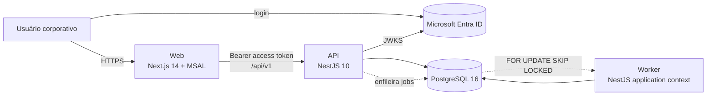
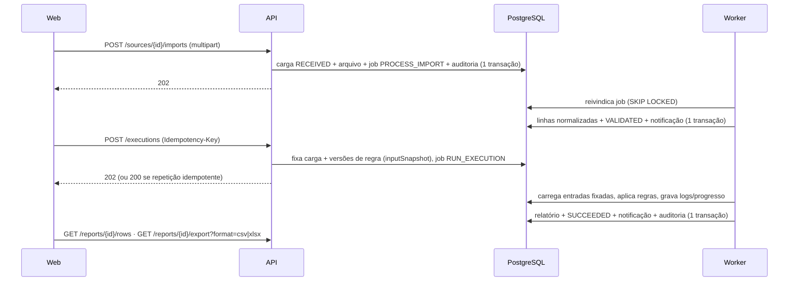

# Arquitetura do ConsolidaHub

> Documento vivo: descreve o que está **implementado** no repositório. Decisões estão em
> [`adr/`](adr/); pendências para produção em
> [`../auditoria/06-pendencias-para-producao.md`](../auditoria/06-pendencias-para-producao.md).

## 1. Objetivo e escopo do MVP

Plataforma corporativa para cadastrar e versionar regras de negócio, importar bases externas,
executar as regras de forma rastreável e produzir o **Relatório Consolidado**, substituindo o
script Power Query original (referência funcional nos documentos do projeto).

| Capacidade do MVP | Implementação |
| --- | --- |
| Login corporativo Microsoft Entra ID | SPA com MSAL (Authorization Code + PKCE); a API valida o access token (RS256/JWKS) — [autenticacao.md](autenticacao.md) |
| Usuários e permissões | Identidade externa (`tid`,`oid`) → usuário local; papéis e permissões no banco; guard global *deny-by-default* |
| Regras: cadastro, versionamento, desativação | Versões imutáveis, concorrência otimista (`expectedVersion`), regras nascem inativas |
| Bases de entrada | Cadastro com origem, formato, colunas esperadas e metadados; cargas CSV/XLSX validadas de forma assíncrona |
| Processamento com regras | Motor determinístico (6 tipos) executado pelo worker com entradas fixadas — [processamento.md](processamento.md) |
| Histórico de execuções | Status, datas, solicitante, volumes, erros, logs por etapa, progresso, cancelamento, reprocessamento |
| Relatório Consolidado | Consulta paginada e exportação CSV/XLSX (com proteção contra injeção de fórmulas) |
| Notificações básicas | Notificações internas (in-app) de sucesso/falha de cargas e execuções |
| Auditoria | Trilha somente-inclusão de todas as mutações e negações de acesso |

Fora do MVP (não implementado de propósito): aprovação multinível, BI completo, sugestões de
regras por IA, aplicativo móvel, parametrização granular por unidade, conectores remotos
(SQL/SharePoint/API) e a lógica **Variável** (aguarda especificação — [semântica do motor](../regras/semantica-do-motor.md)).

## 2. Visão de contêineres



* **web/** — pacote npm separado (Next.js 14 App Router, React 18, MSAL). Só fala com a API.
* **API** (`src/main.ts`) — HTTP, autenticação, autorização, validação, casos de uso, enfileiramento.
* **Worker** (`src/worker.ts`) — mesmo código e imagem da API, outro processo: consome a fila de
  jobs (validação de cargas e execuções). Pode ter várias réplicas.
* **PostgreSQL** — único estado da aplicação: dados, arquivos enviados, fila de jobs, auditoria.

Não há Redis, broker de mensagens nem armazenamento de objetos no MVP
([ADR-0002](adr/0002-fila-de-jobs-no-postgresql.md)).

## 3. Camadas e módulos (monólito modular)

```
src/
  main.ts, http-app.ts, app.module.ts   # bootstrap HTTP (helmet, CORS, limites, prefixo /api/v1, guards globais)
  worker.ts, worker/                    # bootstrap do worker, JobRunner, liveness
  config/                               # configuração tipada e validada (variáveis de ambiente)
  database/                             # seed idempotente e CLI de concessão de papel
  shared/
    domain/        # erros, paginação, hashing, dados tabulares, texto — sem framework
    application/   # portas (TransactionRunner, AuditRecorder, JobQueue, NotificationPublisher, Clock)
    validation/    # validador explícito de entrada (sem class-validator)
    infrastructure/# Prisma, auditoria, fila, notificações, logs JSON, contexto da requisição
    presentation/  # envelope de resposta, filtro de exceções, middleware de contexto
  modules/<módulo>/
    domain/        # regras puras (ex.: motor de regras, máquina de estados da execução)
    application/   # casos de uso + portas do módulo (interfaces de repositório)
    infrastructure/# adaptadores Prisma, parsers CSV/XLSX, verificador de tokens
    presentation/  # controllers Nest + parsers de requisição (*.requests.ts)
```

Módulos: `auth`, `users`, `sources` (bases e cargas), `rules`, `executions`, `reports`,
`notifications`, `audit`, `health`.

Regras de dependência:

* `domain` e `application` não importam NestJS nem Prisma; dependem de **portas** (interfaces)
  ligadas por *tokens* nos módulos Nest (`useFactory`). Isso permite testar casos de uso e o motor
  com *fakes* em memória (testes unitários) e trocar adaptadores.
* `presentation` converte HTTP ↔ comandos usando parsers explícitos (`*.requests.ts`), que
  rejeitam propriedades desconhecidas e acumulam todos os problemas encontrados.
* Cada módulo expõe um `*CoreModule` (casos de uso + adaptadores, sem controllers), reutilizado
  pelo worker, e o módulo HTTP (controllers).

## 4. Pipeline HTTP

Ordem por requisição: `RequestContextMiddleware` (gera/valida `x-request-id`, AsyncLocalStorage) →
`ThrottlerGuard` (limite por IP) → `AuthenticationGuard` (token Entra) → `AuthorizationGuard`
(permissões) → parsers de entrada → caso de uso → `ResponseEnvelopeInterceptor` →
`ApiExceptionFilter`.

* Prefixo `/api/v1`; contrato em [`contracts/openapi.yaml`](../../contracts/openapi.yaml) (único).
* Sucesso: `{ "success": true, "data": …, "metadata"?: {paginação} }`.
* Erro: `{ "success": false, "error": { "code", "message", "details"?, "requestId" } }` — códigos
  estáveis (`VALIDATION_FAILED`, `INSUFFICIENT_PERMISSIONS`, `RULE_VERSION_CONFLICT`, …); exceções
  inesperadas viram `500 INTERNAL_ERROR` sem detalhes internos (o detalhe vai para o log com o
  `requestId`).
* Segurança de transporte e cabeçalhos: helmet (CSP `default-src 'none'`), sem `x-powered-by`,
  CORS com lista exata de origens, corpo JSON ≤ 1 MB, upload por multipart com limite de tamanho,
  `trust proxy` configurável, *query parser* simples (sem objetos aninhados).

## 5. Autenticação e autorização (resumo)

1. O SPA obtém um access token para o escopo `api://<api>/access_as_user` (MSAL, PKCE).
2. A API valida assinatura RS256 com a JWKS do tenant (cache com renovação), `iss`, `aud`, `tid`,
   `exp`/`nbf`/`iat`, `ver = 2.0`, `scp`, `azp` (aplicativos cliente permitidos) e `oid`.
3. A identidade é (`provider`, `tid`, `oid`) — nunca o e-mail. No primeiro acesso o usuário é
   provisionado **sem papéis** (JIT); claims de papéis do token são ignoradas.
4. Papéis e permissões (`recurso:ação`) vêm do banco a cada requisição; usuário inativo recebe 403.
5. Toda rota precisa de política explícita (`@Public`, `@AuthenticatedOnly` ou
   `@RequirePermissions`); rota sem política responde 403 (`ACCESS_POLICY_MISSING`) — e o teste de
   contrato falha.
6. Acesso por ID: recursos compartilhados (regras, bases, execuções, relatórios) são protegidos
   pela permissão do recurso; notificações são do dono (outro usuário recebe 404).

Detalhes: [autenticacao.md](autenticacao.md) e [seguranca.md](seguranca.md).

## 6. Fluxo principal



Garantias: nenhuma carga ou relatório parcial fica visível; repetição da mesma requisição com a
mesma `Idempotency-Key` não cria outra execução; uma execução sempre usa exatamente as versões de
regra e cargas registradas no snapshot (reprocessamento reproduzível). Ver
[processamento.md](processamento.md).

## 7. Persistência

* Prisma 5.22 + PostgreSQL 16; schema em `prisma/schema.prisma`, uma migration de base
  (`prisma/migrations/20261023000000_baseline`) com restrições adicionais (CHECKs) e triggers que
  tornam `audit_events` somente-inclusão e `rule_versions` imutável.
* Tabelas (snake_case): identidade e acesso (`users`, `external_identities`, `roles`,
  `permissions`, `role_permissions`, `user_roles`), bases e cargas (`sources`, `data_imports`,
  `import_files`, `import_chunks`), regras (`rules`, `rule_versions`), processamento
  (`executions`, `execution_logs`, `background_jobs`), resultados (`reports`, `report_chunks`),
  `notifications` e `audit_events`.
* Dados tabulares são gravados em blocos JSONB de 1.000 linhas (`import_chunks`, `report_chunks`);
  a paginação de linhas lê apenas os blocos necessários.
* O arquivo original enviado fica em `import_files` (bytea) para rastreabilidade (limite padrão
  20 MB). Política de retenção: pendente de decisão de negócio.
* Migrations são aplicadas com `prisma migrate deploy` por um job dedicado; a aplicação usa um
  papel de banco só com DML ([guias/banco-de-dados.md](../guias/banco-de-dados.md)). `db push`
  não é usado.

## 8. Auditoria, logs e observabilidade

* **Auditoria** (`audit_events`): ator, ação, entidade, resultado (`SUCCESS`/`FAILURE`/`DENIED`),
  `requestId`, IP, user-agent e detalhes sem dados sensíveis; gravada na **mesma transação** da
  mutação. Negações de acesso também são auditadas. Consulta: `GET /audit-events` (`audit:view`).
* **Logs**: JSON em stdout (um objeto por linha) com `requestId`, `userId` e redação de campos
  sensíveis (tokens, senhas, segredos, cookies). Sem e-mail nos logs.
* **Saúde**: `GET /api/v1/health/live` (processo) e `/health/ready` (banco). Worker: arquivo de
  heartbeat e/ou `GET /health/live` em porta interna (`WORKER_HEALTH_PORT`).
* Métricas e tracing (OpenTelemetry) **não** estão implementados — pendência registrada.

## 9. Configuração

Variáveis validadas na inicialização (`src/config/app-config.ts`); valores inválidos abortam o
processo listando apenas os **nomes** das variáveis. Modelo comentado em
[`.env.example`](../../.env.example) e [`web/.env.example`](../../web/.env.example). Em produção:
`CORS_ALLOWED_ORIGINS` (https) e `ENTRA_ALLOWED_CLIENT_IDS` são obrigatórias.

## 10. Infraestrutura

* Local: `docker-compose.yml` (PostgreSQL só em `127.0.0.1`, migração como serviço de execução
  única, API, worker e web com sistema de arquivos somente-leitura).
* Nuvem: Azure Container Apps + PostgreSQL Flexible Server privado + Key Vault + ACR, descritos em
  `infra/terraform` ([ADR-0004](adr/0004-azure-container-apps.md)). **A infraestrutura não foi
  provisionada nem validada com `terraform plan` nesta etapa.**
* CI/CD: GitHub Actions (`ci.yml`, `codeql.yml`, `deploy.yml`) com actions fixadas por SHA,
  OIDC para o Azure e tags de imagem imutáveis (SHA do commit).

## 11. Contrato da API

`contracts/openapi.yaml` (OpenAPI 3.1) é a fonte única da API HTTP. O teste
`test/contract/openapi.contract-spec.ts` compara o contrato com os controllers (rotas, códigos de
sucesso, permissões exigidas, rotas públicas) e verifica a consistência interna do documento
([ADR-0003](adr/0003-contrato-openapi-unico.md), [guia](../guias/contrato-openapi.md)). Clientes
futuros (desktop/móvel) devem consumir o mesmo contrato; a API não depende do frontend.
